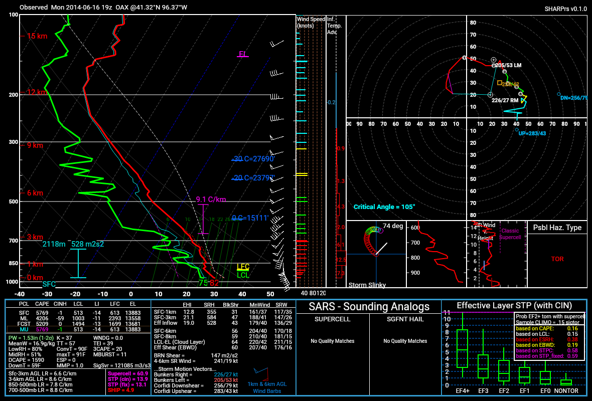

<h1 align="center">SHARPrs</h1>

<p align="center"><strong>Analyze atmospheric soundings and draw customizable SPC-style charts in Rust.</strong></p>

<p align="center">
  <a href="https://github.com/PettusWX/SHARPrs/actions/workflows/desktop.yml"></a>
  <a href="crates/sharprs-desktop"></a>
  <a href="crates/sharprs-core"></a>
  <a href="LICENSE"></a>
</p>

Use the desktop app to inspect a profile, the CLI to render a forecast run, or the library to work with parcel and wind diagnostics in your own code.



## Try a sounding

From a checkout of this repository with a current stable Rust toolchain, run:

```sh
cargo run --locked --release -p sharprs-desktop
```

The app opens with the Omaha sounding shown above. Drag a file into the window or choose **Fetch observation** to retrieve a radiosonde by station and UTC time. BUFKIT files with multiple profiles have a forecast-hour selector.

Click a level on the Skew-T to lift a parcel there. Click either bottom inset to change what it displays. **Customize** controls the traces, colors, units, storm motion, headers, and image size. You can save settings as a preset and export the chart as a PNG.

## Command line

```sh
cargo install --locked --path crates/sharprs-cli

sharprs plot examples/data/sharppy/14061619.OAX -o omaha.png
sharprs params examples/data/sharppy/14061619.OAX --json
sharprs fetch KOAX --time 2024-07-24T00:00Z -o koax.json
sharprs plot koax.json --user-parcel 925,25,20 --storm-motion 270,20,180,15 -o scenario.png
```

A user parcel takes pressure in hPa, temperature in °C, and dewpoint in °C. Storm motion takes the right mover followed by the left mover, each as direction **from** in degrees and speed in knots.

SHARPrs reads SPC text, BUFKIT, University of Wyoming soundings, IEM RAOB JSON, and column-labeled CSV. Use `sharprs info` to list the profiles in a file, `sharprs convert` to write SPC text or CSV, and `sharprs gallery` to batch-render a manifest. Local files work offline.

## Rust library

Add the facade crate to your project:

```toml
[dependencies]
sharprs = { git = "https://github.com/PettusWX/SHARPrs" }
```

```rust
use sharprs::{Analyzed, Select, load};

fn main() -> Result<(), Box<dyn std::error::Error>> {
    let sounding = load("koax.json", Select::First)?;
    let result = Analyzed::new(&sounding)?;
    println!("Mixed-layer CAPE (J/kg): {:?}", result.analysis.parcels.ml.cape);
    std::fs::write("koax.png", result.render_png(&Default::default())?)?;
    Ok(())
}
```

The optional `observations` feature enables IEM retrieval. Decoding, analysis, and rendering are available in the default build.

## Desktop packages

The [desktop builds](https://github.com/PettusWX/SHARPrs/actions/workflows/desktop.yml) produce ZIP archives for macOS (Apple silicon and Intel) and Windows x64. Each archive includes the app and CLI. The macOS app is signed ad hoc. The Windows build is unsigned.

## License and credits

SHARPrs is distributed under the [BSD 3-Clause License](LICENSE). [SHARPpy](https://github.com/sharppy/SHARPpy) is the numerical reference. Bundled data and fonts carry their own notices. [Data credits](crates/sharprs-core/NOTICE) · [SHARPpy examples](examples/data/sharppy/LICENSE.rst) · [Roboto](crates/sharprs-render/fonts/roboto/LICENSE.txt) · [Arimo](crates/sharprs-render/fonts/arimo/OFL.txt)
